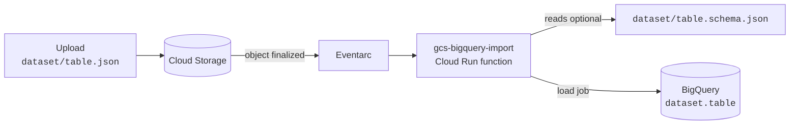

# gcs-bigquery-import

[](https://github.com/lukwam/gcs-bigquery-import/actions/workflows/ci.yml)
[](https://github.com/lukwam/gcs-bigquery-import/actions/workflows/ci.yml)
[](LICENSE)

[](https://github.com/astral-sh/ruff)
[](https://github.com/astral-sh/ty)


Drop a file in a Cloud Storage bucket and it shows up as a BigQuery table.

```text
gs://my-bucket/sales/orders.json  ──▶  my-project.sales.orders
```



## How it works

| You upload | It loads into | Format |
| --- | --- | --- |
| `sales/orders.json` (also `.jsonl`, `.ndjson`) | `sales.orders` | Newline-delimited JSON |
| `sales/orders.csv` | `sales.orders` | CSV with a header row |
| `sales/orders.parquet` / `.avro` / `.orc` | `sales.orders` | Self-describing formats |
| `sales/orders.json.gz` / `.csv.gz` | `sales.orders` | Gzipped JSON or CSV |

- **Datasets** are created on first use, in `DATASET_LOCATION`.
- **Tables are replaced** on each upload by default (`WRITE_TRUNCATE`). Set `WRITE_DISPOSITION=WRITE_APPEND` to append instead, or override one upload with object metadata:

  ```bash
  gcloud storage cp orders.json gs://my-bucket/sales/ --custom-metadata=bq-write-disposition=WRITE_APPEND
  ```

- **Schemas** are autodetected for JSON and CSV unless you upload a [BigQuery JSON schema](https://cloud.google.com/bigquery/docs/schemas#specifying_a_json_schema_file) next to the data as `dataset/table.schema.json`. Upload the schema *before* the data.
- **Anything else** (other paths, nested folders, unknown extensions) is ignored.
- **Failures are logged**: the function waits for each load job, then logs the row count or BigQuery's error details as structured JSON in Cloud Logging.

> [!NOTE]
> Dataset names may contain only letters, numbers, and underscores. Table names may also contain dashes.

## Deploy

### Option 1: Terraform (recommended)

Creates the upload bucket, a least-privilege service account, IAM bindings, and the function.

```bash
cd terraform
cp terraform.tfvars.example terraform.tfvars   # set project_id and bucket_name
terraform init
terraform apply
```

### Option 2: gcloud

Deploys against an existing bucket, running as the default compute service account.

```bash
PROJECT=my-project BUCKET=my-bucket ./deploy.sh
```

The function and bucket must be in compatible locations (for example, both in `us-central1`, or a `US` multi-region bucket with a US region).

## Try it

```bash
gcloud storage cp examples/demo/pets.schema.json gs://my-bucket/demo/
gcloud storage cp examples/demo/pets.json examples/demo/species.csv gs://my-bucket/demo/
bq query --use_legacy_sql=false 'SELECT * FROM demo.pets'
```

## Configuration

| Variable | Default | Description |
| --- | --- | --- |
| `BQ_PROJECT` | the function's project | Project that holds the datasets |
| `WRITE_DISPOSITION` | `WRITE_TRUNCATE` | `WRITE_TRUNCATE`, `WRITE_APPEND`, or `WRITE_EMPTY` |
| `CREATE_DATASETS` | `true` | Create missing datasets; if `false`, uploads to unknown datasets fail |
| `DATASET_LOCATION` | `US` | Location for newly created datasets |
| `LOAD_TIMEOUT` | `300` | Seconds to wait for a load job before giving up |

## Development

```bash
uv venv && source .venv/bin/activate
uv pip install -r requirements-dev.txt
pre-commit install   # ruff, ty, markdownlint, and terraform fmt on every commit
pytest --cov=main    # tests with coverage
```

`pre-commit run --all-files` runs every check at once; CI runs the same hooks plus the tests on Python 3.12 and 3.13 and `terraform validate`.

Run it locally against a real project with the [Functions Framework](https://github.com/GoogleCloudPlatform/functions-framework-python):

```bash
BQ_PROJECT=my-project functions-framework --target=gcs_bigquery_import --signature-type=cloudevent
```

## Upgrading from v1

v1 (2018) was a 1st-gen Cloud Function on the retired `python37` runtime. Changes in v2:

- The entry point is renamed from `bigqueryImport` to `gcs_bigquery_import`, and it deploys as a 2nd-gen Cloud Run function.
- Load job settings now apply as intended. In v1, stray trailing commas turned them into tuples.
- Errors are reported. v1 never waited for the load job, so failures were silent.
- New: CSV, Parquet, Avro, ORC, gzip, schema files, append mode, and a Terraform example.
